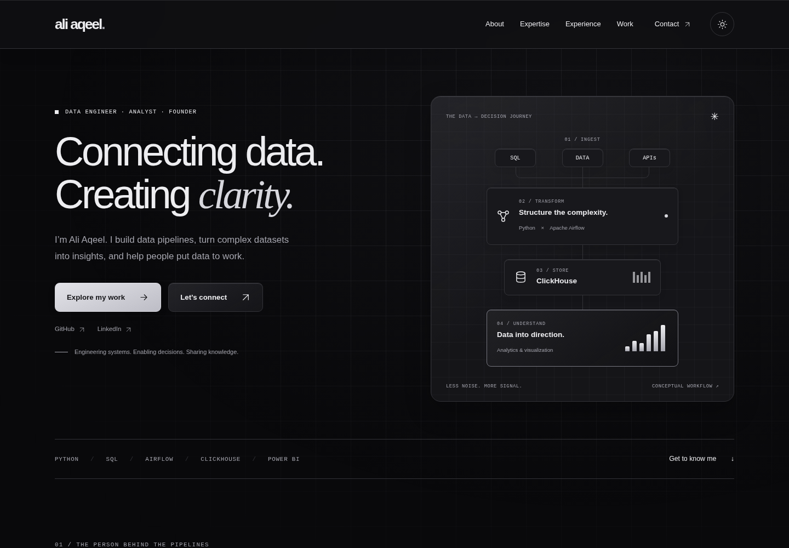
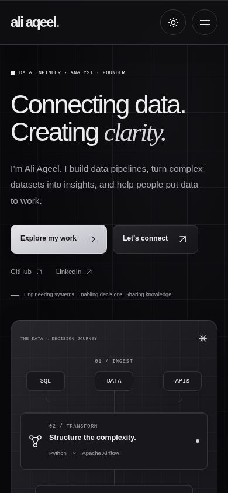

# Black / glass redesign previews

Captured from the local implementation in Chromium on October 22, 2026. These are review images, not website runtime assets. The site content and structure are preserved; black is the default and neutral light mode remains optional.

| Preview | Viewport |
| --- | --- |
| [Desktop — black](desktop.png) | 1440 × 1000 |
| [Desktop — skills](desktop-skills.png) | 1440 × 1000 |
| [Desktop — projects](desktop-projects.png) | 1440 × 1000 |
| [Desktop — contact](desktop-contact.png) | 1440 × 1000 |
| [Desktop — optional light theme](desktop-light.png) | 1440 × 1000 |
| [Tablet](tablet.png) | 768 × 1024 |
| [Mobile](mobile.png) | 390 × 844 |
| [Mobile — navigation](mobile-menu.png) | 390 × 844 |
| [Mobile — contact validation preview](mobile-contact.png) | 390 × 844 |

The mobile contact image contains test input entered during verification; the form does not send or store it. Still images do not show the subtle scroll-reactive grid effect. Open the local `index.html` to review the animation; with reduced motion enabled the grid stays static.

